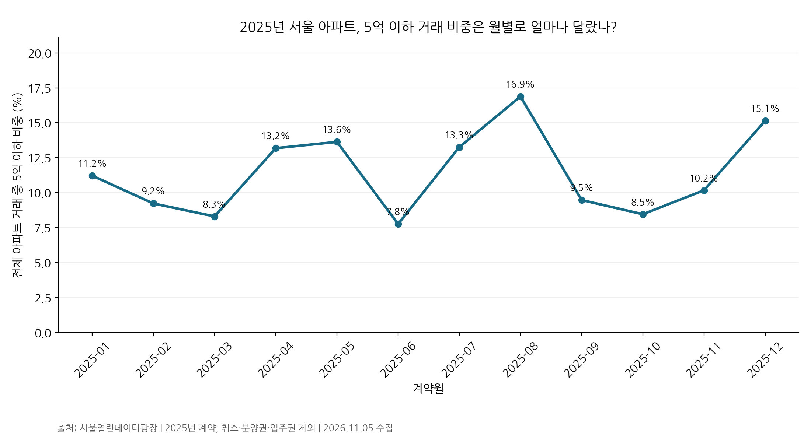
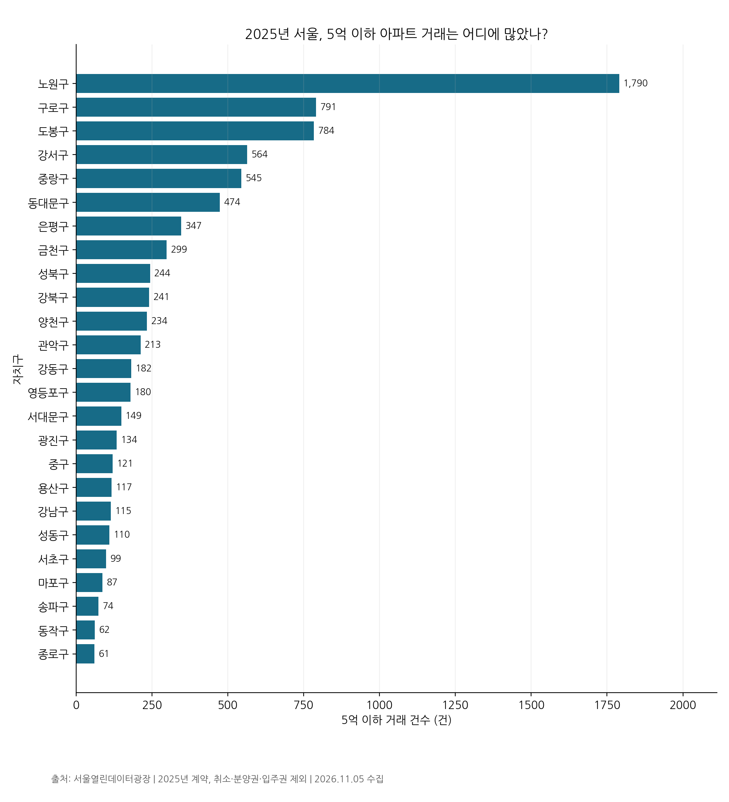
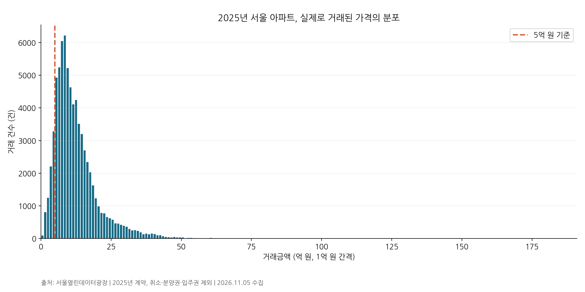
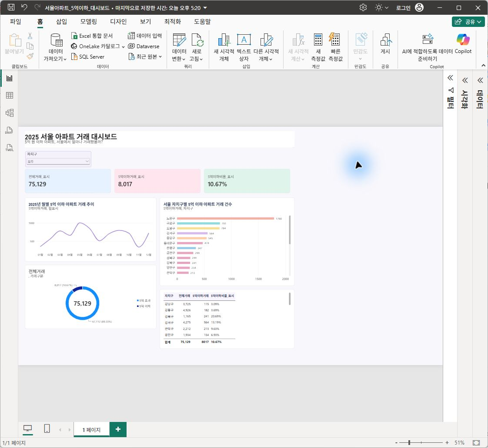
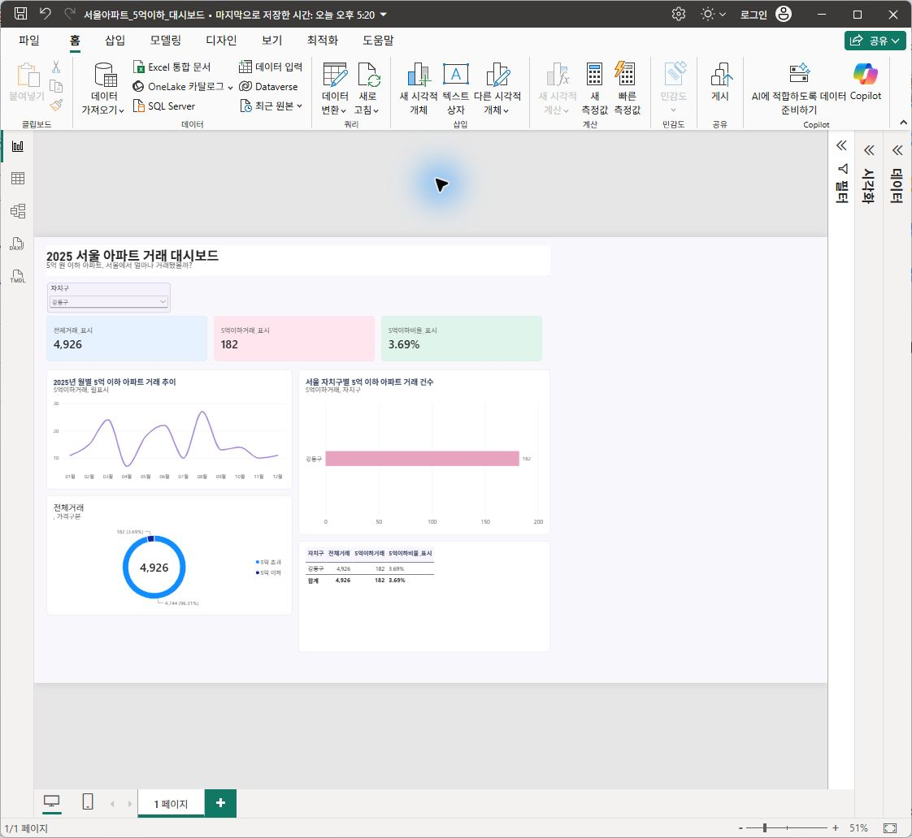

# 2025년 서울 아파트 실거래 분석

6차 과제에서 2025년 서울 아파트 매매 실거래를 분석했습니다. 전체 **75,129건** 중 **8,017건(10.67%)**이 5억 원 이하였습니다. 5억 원 이하 거래가 가장 많았던 자치구는 노원구로 **1,790건**이었습니다.

## 파일 및 실행 방법

| 파일 | 용도 |
| --- | --- |
| [Colab 노트북](notebooks/seoul-apartments-2025.ipynb) | 차트 3종과 월별·자치구별 요약 재생성 |
| [Power BI 보고서](power-bi/seoul-apartments-2025.pbix) | 숫자 카드, 자치구 슬라이서, 차트, 비교표 |
| [분석용 CSV](data/seoul-apartments-2025.csv) | 노트북과 Power BI에서 사용하는 입력 데이터 |
| [월별 요약](results/monthly-summary.csv) · [자치구별 요약](results/district-summary.csv) | 분석 결과를 담은 집계표 |
| [이미지](images/) | 기사용 차트 3장과 Power BI 화면 2장 |

**Colab**에서 [노트북 열기](https://colab.research.google.com/github/YuNi-100/data-visualization/blob/main/notebooks/seoul-apartments-2025.ipynb)를 누른 뒤 **런타임 → 모두 실행**을 선택합니다. CSV를 내려받고 차트와 집계표를 `generated`의 새 폴더에 저장합니다. 한글 글꼴이 없는 Colab 런타임에는 나눔고딕을 설치합니다. Google Drive 연결이나 GPU는 필요하지 않습니다.

**Power BI Desktop**에서는 `power-bi` 폴더의 PBIX와 `data` 폴더의 CSV를 내려받습니다. 저장소 전체를 받으려면 **Code → Download ZIP**을 사용하세요. PBIX의 저장된 데이터로 차트와 필터를 사용할 수 있습니다. 새로 고침 전에는 **홈 → 데이터 변환**에서 쿼리의 **원본** 단계를 열고 파일 경로를 내려받은 CSV의 위치로 바꾼 뒤 **닫기 및 적용**을 선택합니다. 기본 화면이 강동구로 열리면 자치구 슬라이서 선택을 해제해 서울 전체를 볼 수 있습니다.

## 기사용 차트

### 월별 5억 원 이하 거래 비중

8월이 **16.88%**로 가장 높고 6월이 **7.76%**로 가장 낮았습니다.

### 자치구별 5억 원 이하 거래 건수

### 전체 아파트 거래가격 분포

거래가격 중앙값은 **10.45억 원**이었습니다. 점선은 5억 원 기준을 표시합니다.

## Power BI 필터 비교

| 자치구 선택 | 전체 거래 | 5억 원 이하 거래 | 5억 원 이하 비중 |
| --- | ---: | ---: | ---: |
| 모두 | 75,129건 | 8,017건 | 10.67% |
| 강동구 | 4,926건 | 182건 | 3.69% |

## 데이터 출처와 집계 기준

서울특별시의 [서울시 부동산 실거래가 정보](https://data.seoul.go.kr/dataList/OA-21275/S/1/datasetView.do)를 2026년 11월 5일에 수집해 가공했습니다. 원본 데이터에 적용되는 이용 조건은 **공공누리 제1유형(출처표시)**입니다.

2025년에 계약한 서울 아파트 매매를 집계했으며 취소 거래, 분양권, 입주권을 제외했습니다. 정확히 5억 원인 거래도 5억 원 이하로 집계했습니다. 비중의 분모는 같은 월 또는 자치구에 포함된 전체 거래 건수입니다.
